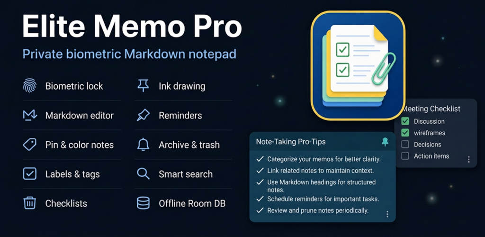

# Elite Memo Pro

**A local-first Android notes app — text, checklists and freehand drawing — built with Kotlin and Jetpack Compose.**

## Overview

Elite Memo Pro brings text notes and freehand drawings together in one app. Write notes with titles and checklists, sketch on a canvas with pen, marker, highlighter, selection and eraser tools, and keep everything organised with labels, colours, pins, search, reminders, and a built-in archive and trash.

The app is **local-first**: notes, labels and settings live in an on-device Room database and DataStore. There is no account, no server, and no `INTERNET` permission.

## Features

**Notes**
- Text notes with a title and body.
- Inline checklists with per-item completion state.
- Per-note colour and pinning.

**Drawing**
- Freehand drawing notes with pen, marker, highlighter, selection and eraser tools.
- Eraser in segment (touch-only) or whole-stroke mode.
- Undo and redo for drawing edits.
- Canvas backgrounds: blank, ruled, grid or dotted.
- A colour palette sheet for stroke colours.
- Selection actions: select all strokes, then duplicate, delete or recolour them.
- The colour and size chosen for each tool are remembered between visits.

**Organise**
- Labels: add, rename, delete and apply.
- Search across titles, body text and tags, with colourful match highlighting; filter by label or colour.
- Sort by last modified, date created, title or colour; grid and list layouts on the home screen.
- Archive to set notes aside, and Trash with restore or permanent delete (plus empty-trash); trashed notes are cleared automatically after 30 days.

**Reminders & security**
- A per-note reminder that posts a notification opening the note.
- Light, dark or system appearance.
- Optional app lock using biometrics or the device credential.

**Extras**
- Home-screen widget: pin checklist notes and tick items off without opening the app.
- Share a note as plain text.
- Back up and restore all notes to a JSON file in Downloads, with optional automatic backups.
- Counts for active notes, pinned notes and words in Settings.
- Edge-to-edge Material 3 interface.

## Screenshots

  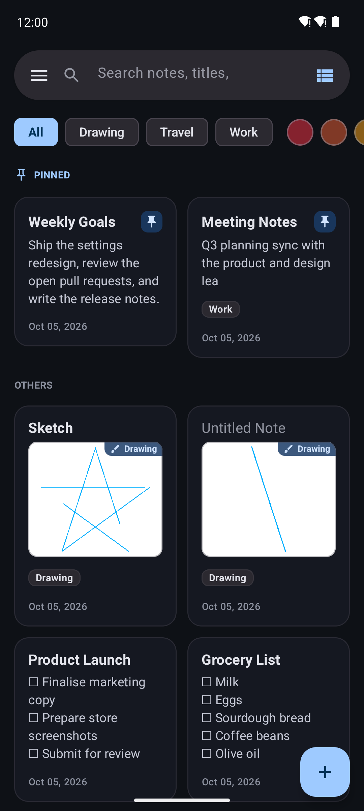
  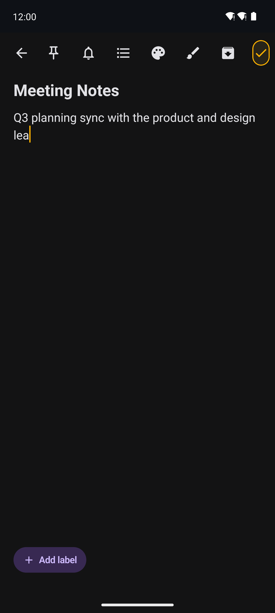
  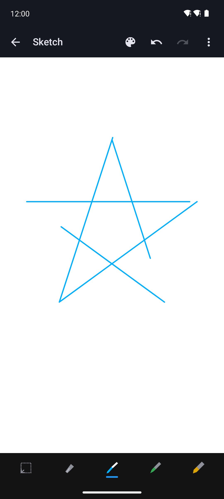
  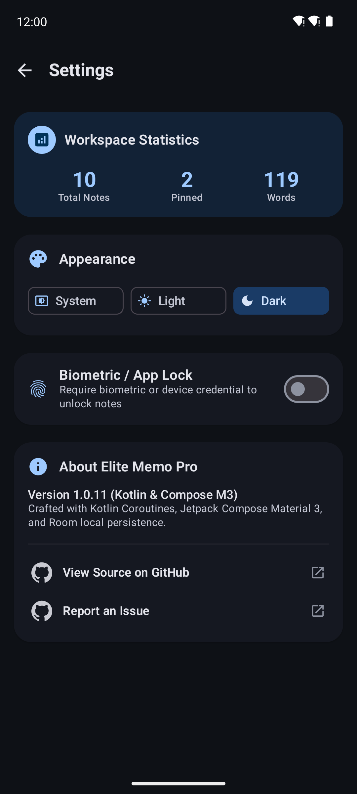

View all screenshots

| Screen | Preview |
|---|---|
| Home (grid) |  |
| Home (list) | 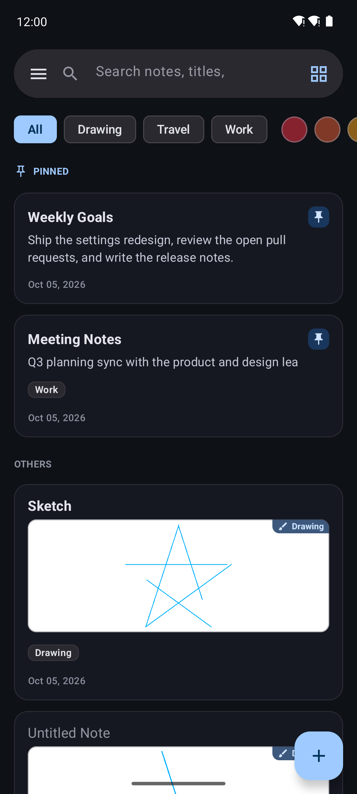 |
| Search results | 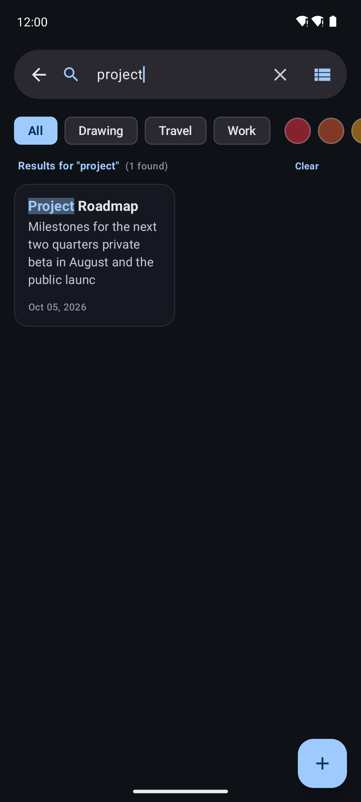 |
| Navigation drawer | 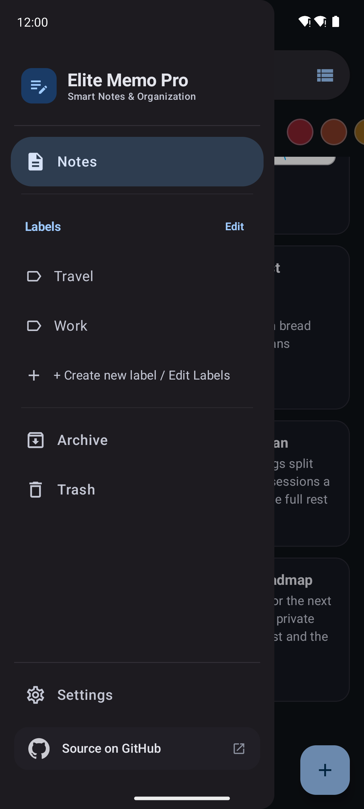 |
| Note editor |  |
| Labels sheet | 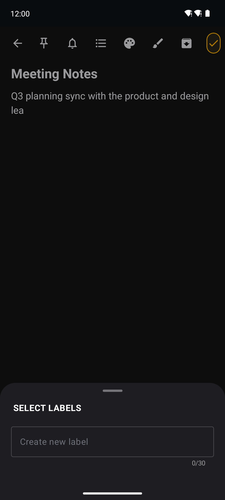 |
| Colour picker | 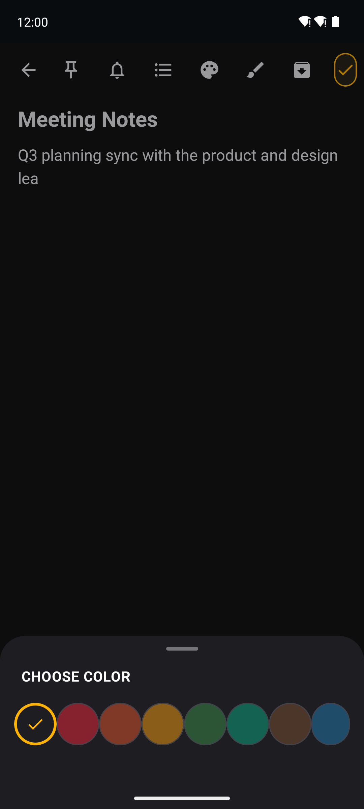 |
| Checklist editor | 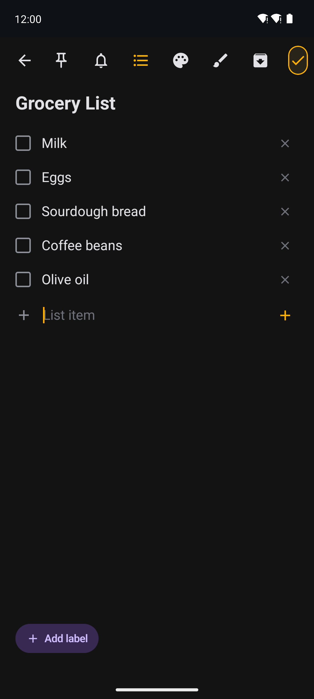 |
| Drawing note |  |
| Archive | 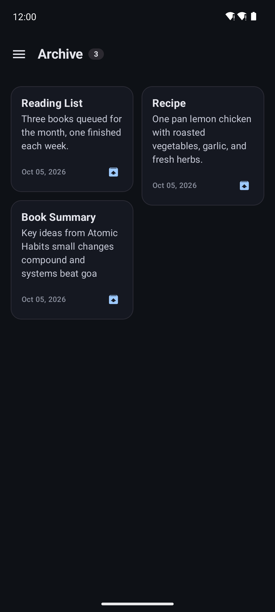 |
| Trash | 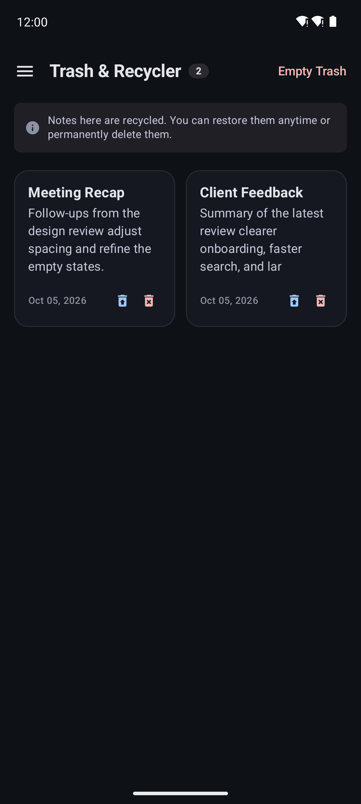 |
| Settings |  |
| Reminder dialog | 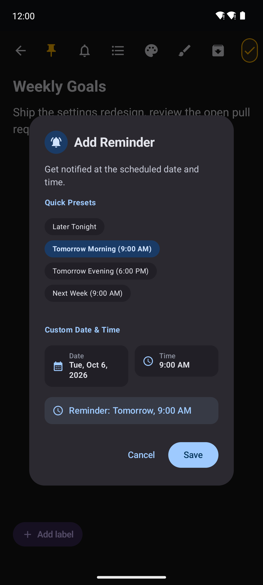 |
| Reminder applied | 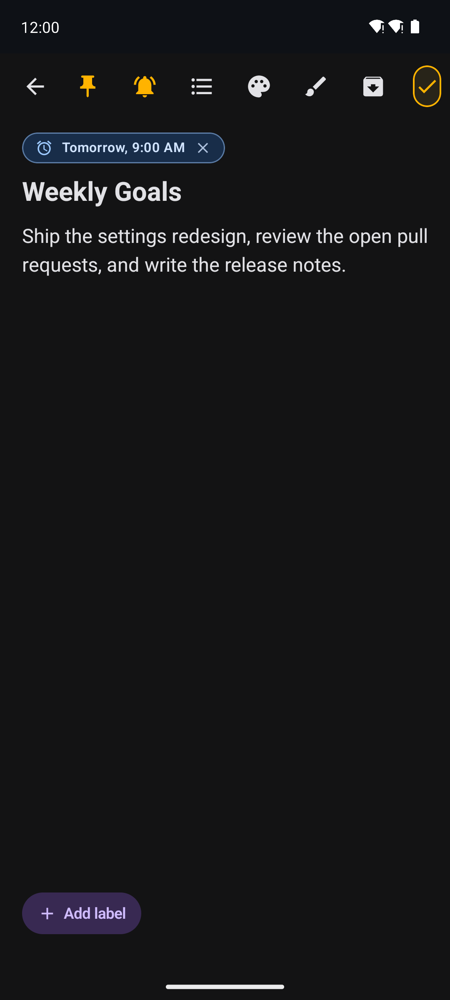 |

## Install

Download the signed APK from the [latest release](https://github.com/deepanjanxyz/notepad/releases/latest) and open it on your device. Elite Memo Pro runs on Android 7.0 (API 24) and newer.

## Roadmap

Planned work, roughly in order. Priorities can shift, and issues or pull requests on any of these are welcome.

- [ ] **Rich-text formatting** *(high priority)* — bold, italic, underline, bullet lists, headings and links inside a note.
- [ ] **Calendar view** — see which days have notes and open a day's notes from a calendar, keeping the created date and the reminder date separate.
- [ ] **Bulk note actions** — select several notes and archive, delete, re-label, recolour or export them together.
- [ ] **Drawing improvements** — quicker stroke-thickness changes, custom colours, canvas zoom and pan, and stylus-pressure pen width where the device supports it.
- [ ] **Encrypted backup** — a password-protected, encrypted backup file beside the JSON one, restorable on another device, with no cloud or server.
- [ ] **Reading & editor customization** — font size, line spacing and a distraction-free reading view.
- [ ] **Markdown export/import** — export and import notes as Markdown and share several notes at once, staying compatible with the current format.

## License

Released under the **MIT License**. See [LICENSE](LICENSE).

---

Built with Kotlin and Jetpack Compose. Contributions are welcome — see <a href="CONTRIBUTING.md">CONTRIBUTING.md</a> and the <a href="CODE_OF_CONDUCT.md">Code of Conduct</a>.

